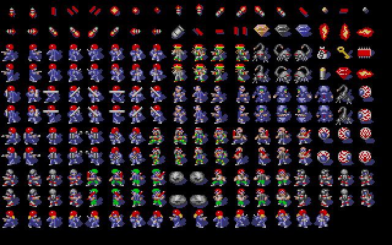

# Everything To Pieces Shooter

Everything To Pieces Shooter is one of [Richèl Bilderbeek's games](https://richelbilderbeek.github.io/games/).

A simple top-down 2D shooter, written in C++.

## Screenshots

## Links

- [Source code](https://github.com/richelbilderbeek/EverythingToPiecesShooter)
